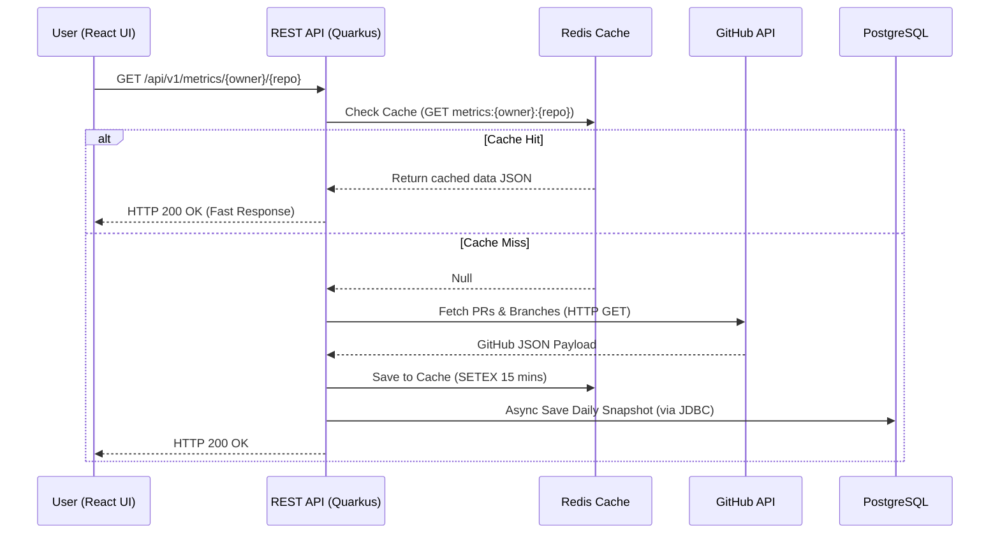
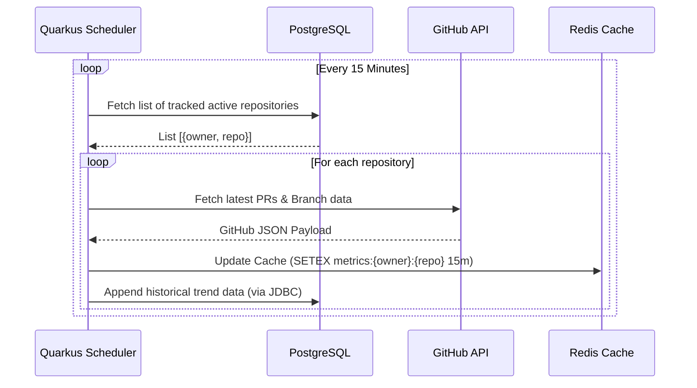

# GitPulse: Application Design & Master Plan

> **Project Name:** GitPulse (Engineering Intelligence & Repository Health Tracker)  
> **Target Stack:** Java (Quarkus), PostgreSQL, Redis, React + TypeScript, Maven, JUnit 5.
> **Focus:** Application Build, Scheduling, and Data Flow (DevOps deployment phases deferred).

---

## 1. System Architecture & Overview

GitPulse is a REST API and analytics dashboard designed to monitor GitHub repository hygiene. It aggregates pull request review statuses, flags stale unmerged branches, and identifies PRs stuck in review for over 48 hours. To ensure high availability and protect against GitHub API rate-limit exhaustion, it utilizes Redis for caching and a background scheduler for proactive cache warming.

```text
+--------------------------+       +------------------------------------+       +------------------------+
| React + TypeScript UI    | ----> | Java REST API                      | ----> | GitHub REST API v3     |
| (Vite Dev Server)        |       | (Quarkus / Port 8080)              |       | (External Dependency)  |
+--------------------------+       +------------------------------------+       +------------------------+
                                         |                    |
                                         v                    v
                               +-------------------+--------------------+
                               | Redis Cache       | PostgreSQL DB      |
                               | (Rate Limiting)   | (Plain JDBC)       |
                               +-------------------+--------------------+
                                         ^
                                         | (Updates Cache Background)
                               +-------------------+
                               | Quarkus Scheduler |
                               | (@Scheduled Task) |
                               +-------------------+
```

---

## 2. Sequence Diagrams

### 2.1 API Request Flow (Read-Through Cache)
This diagram illustrates how the system handles a direct user request, utilizing Redis to prevent unnecessary outbound calls to GitHub.



### 2.2 Proactive Cache Warming (Background Scheduler)
To ensure fast load times and keep data fresh without relying solely on user traffic, a scheduled task routinely updates tracked repositories in the background.



---

## 3. User Stories & Acceptance Criteria

### 3.1 Functional Requirements
These stories define the core business value and features the user will interact with.

#### User Story 1: Review Bottleneck Identification
**As an** Engineering Lead,  
**I want** an endpoint `/api/v1/metrics/{owner}/{repo}/stuck-prs` that calculates PRs open for over 48 hours without approval,  
**So that** I can unblock team review bottlenecks during daily standups.
*   **AC 1.1:** Given a repository with open PRs created > 48 hours ago lacking an `APPROVED` review state, when requested, the API returns an HTTP 200 payload containing a list of stuck PR IDs, authors, and duration open.
*   **AC 1.2:** Given a PR created < 48 hours ago, it must not be categorized in the `stuck_prs` array.
*   **AC 1.3:** Given an invalid or non-existent repository, the API must return an HTTP 404 with a structured error JSON (`{ "status": 404, "message": "Repository not found" }`).

#### User Story 2: Stale Branch Hygiene
**As a** DevOps Engineer,  
**I want** the system to audit remote repository branches and detect stale branches (> 30 days old with no recent commits),  
**So that** we can prevent repository clutter and security exposure.
*   **AC 2.1:** Given a branch whose latest commit timestamp is > 30 days old, the system flags `is_stale: true`.
*   **AC 2.2:** Given a branch associated with an active, open PR, it must not be flagged as stale regardless of age.
*   **AC 2.3:** The response must return total branch counts alongside stale branch counts for dashboard calculation.

---

### 3.2 Non-Functional Requirements
These stories define system behavior, performance, constraints, and operational mechanisms.

#### User Story 3: Rate Limit Prevention via Redis Caching (Performance/Limits)
**As a** System Administrator,  
**I want** API metrics requests to be cached in Redis with a 15-minute Time-To-Live (TTL),  
**So that** the application does not exceed GitHub's 5,000 requests-per-hour rate limit.
*   **AC 3.1:** Given a request for repository metrics, the application checks Redis first before making outbound HTTP calls to `api.github.com`.
*   **AC 3.2:** Given a cache miss, the system fetches fresh data from GitHub, serves the client, and sets a 15-minute TTL key in Redis.
*   **AC 3.3:** Given a cache hit, the endpoint returns the payload without incrementing GitHub API usage.

#### User Story 4: Proactive Cache Warming Scheduler (Reliability/Freshness)
**As a** System Architect,  
**I want** a background scheduler to automatically refresh cache data for actively tracked repositories every 15 minutes,  
**So that** users experience minimal latency and avoid cache-miss penalties on their first load of the day.
*   **AC 4.1:** The system must run an `@Scheduled` job every 15 minutes.
*   **AC 4.2:** The job must query the PostgreSQL database (using JDBC `PreparedStatement`) for all repositories accessed by users in the last 24 hours.
*   **AC 4.3:** The job fetches new data from GitHub and overwrites the existing Redis cache entries.

#### User Story 5: Response Time SLAs (Performance)
**As an** End User,  
**I want** the dashboard to load repository metrics rapidly,  
**So that** my workflow is not interrupted by long loading screens.
*   **AC 5.1:** Given a cache hit, the API must return the full payload in < 50ms.
*   **AC 5.2:** Given a cache miss, the API must resolve the request and return data in < 2000ms (accounting for GitHub API latency).

---

## 4. Application Build & Implementation Plan

### Phase 1: Backend Setup (Quarkus)
- **Step 1.1: Initialize Project**
  * Scaffold a Quarkus project using Maven.
  * Add extensions: `quarkus-resteasy-reactive-jackson`, `quarkus-redis-client`, `quarkus-jdbc-postgresql`, `quarkus-agroal`, `quarkus-scheduler`, `quarkus-rest-client-reactive`.
- **Step 1.2: GitHub Integration**
  * Create a declarative REST Client (`@RegisterRestClient`) to interface with `https://api.github.com`.
  * Inject the `\${GITHUB_TOKEN}` into request headers using `@ClientHeaderParam`.
- **Step 1.3: Caching & Scheduling Logic**
  * Implement `@CacheResult(cacheName = "repo-metrics")` on the service layer.
  * Implement `CacheSyncTask.java` using `@Scheduled(every = "15m")` to iterate over DB records via JDBC and trigger the GitHub fetch.

### Phase 2: Frontend Setup (React)
- **Step 2.1: Initialize Project**
  * Scaffold using Vite: `npm create vite@latest gitpulse-ui -- --template react-ts`.
- **Step 2.2: Dashboard Components**
  * Build `MetricCard.tsx` for displaying numerical data (Stale Branches, Stuck PRs).
  * Build `RepoSearch.tsx` to input owner/repo and trigger API calls.
  * Use `axios` or `fetch` to interact with `http://localhost:8080/api/v1/metrics/`.

### Phase 3: Local Infrastructure Dependencies
- **Step 3.1: Lightweight Docker Compose (Infra Only)**
  * Run Postgres and Redis locally to support the app development.
  * The Java app and React app will run on the host machine (`mvn compile quarkus:dev` and `npm run dev`).